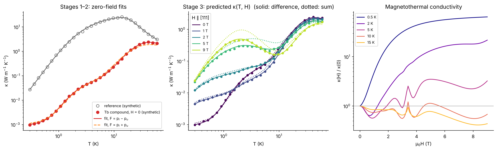
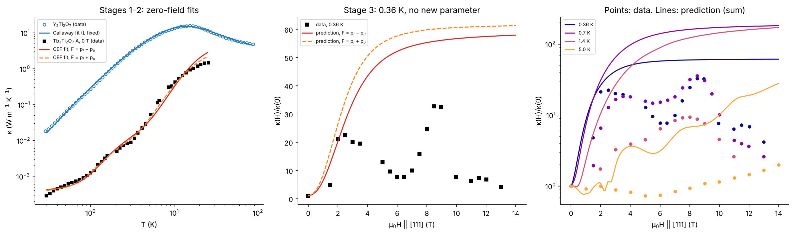
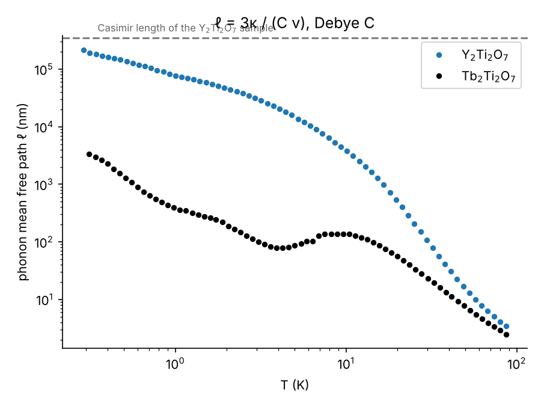

# Callaway-CEF

Phonon thermal conductivity of rare-earth magnetic insulators in a Callaway model, with
resonant phonon scattering on crystal-electric-field (CEF) levels and its evolution in
a magnetic field.

The question behind it: in Tb-based pyrochlores and garnets, κ is orders of magnitude
below that of the non-magnetic analogue and changes strongly with field. How much of
this is captured by independent Tb³⁺ ions whose CEF levels resonantly scatter phonons,
and where does that picture break down?

## Model

$$
\kappa(T)=\frac{k_B}{2\pi^2 v}\left(\frac{k_BT}{\hbar}\right)^3\int_0^{\theta_D/T}\tau_c(x)\,\frac{x^4e^x}{(e^x-1)^2}\,dx,\qquad x=\frac{\hbar\omega}{k_BT}
$$

$$
\tau_c^{-1}=\frac{v}{L}+A\omega^4+B\,\omega^2T\,e^{-\theta_D/bT}
+\sum_{ij}C_{ij}\,\frac{\omega^4}{(\omega_{ij}^2-\omega^2)^2+(\gamma\,\omega_{ij}\omega)^2}\,F_{ij}(T,H)
$$

Boundary, point-defect and umklapp scattering, plus one resonant term per pair of CEF
sublevels (ω_ij = level splitting, F_ij = Boltzmann population factor, either
p_lower − p_upper or p_lower + p_upper — both appear in the literature, and they make
different field predictions). In a field, each (quasi-)doublet splits as
E₀ ± √((Δ/2)² + (m μ_B H cos θ)²), averaged over magnetically inequivalent sites
(for the pyrochlore with H ∥ [111]: ¼ of sites with cos θ = 1, ¾ with cos θ = ⅓).
Energies are handled in kelvin, so A is in s⁻¹K⁻⁴, B in s⁻¹K⁻³, C in s⁻¹.

## Workflow

1. **Reference compound** (e.g. Y₂Ti₂O₇): fit L, A, B with no resonant term.
2. **Magnetic compound at H = 0** (e.g. Tb₂Ti₂O₇): lattice terms fixed, fit the C_ij
   (and the excited-level energy, bounded by the neutron value).
3. **Field**: predict κ(T, H) from stage 2 with *no new free parameter* and compare with
   the measured field data. Agreement or disagreement here is the actual result.

```bash
pip install -r requirements.txt
python demo_synthetic.py                       # validation on synthetic data
python fit.py configs/tb2ti2o7_template.json --stage reference --out lattice.json
python fit.py configs/tb2ti2o7_template.json --stage magnetic --lattice lattice.json --out cef.json
python predict_field.py configs/tb2ti2o7_template.json --lattice lattice.json --cef cef.json
```

Fits are least squares on log κ (the data spans decades) with parameters in log space;
the scripts print 1σ errors and the correlation matrix, which shows directly which
scattering channels the data cannot separate.

## Validation on synthetic data

`demo_synthetic.py` generates data from known parameters (4 % noise) and runs the three
stages. All parameters are recovered within 1–2σ. Two observations from this test:
zero-field data alone barely distinguishes the two population factors (rms deviation
3 % vs 11 %), but the field prediction does (4 % vs 26 %); and the field response is
non-monotonic in both H and T, with sharp features at level crossings.



## Results on published data

Data digitised from Li et al., PRB 87, 214408 (2013); see `data/README.md`.
Run `python run_real.py && python plot_real.py`.

- **Stage 1 (Y₂Ti₂O₇).** With L fixed to the Casimir length of the sample (0.35 mm) and
  θ_D, v from the reported specific-heat β, boundary + dislocation + point-defect + umklapp
  terms fit the whole 0.3–87 K curve to ~5 %.
- **Stage 2 (Tb₂Ti₂O₇, H = 0).** Two CEF doublets (ground quasi-doublet, excited doublet
  bounded to 15–21 K) reproduce the two-orders-of-magnitude suppression and the overall
  shape, but only to 17 % (F = p_l + p_u) or 27 % (F = p_l − p_u); the excited level
  sits at the lower bound.
- **Stage 3 (H ∥ [111], no new parameter).** With m₀ ≈ 6 μ_B (Landé factor ~12 quoted by
  Li et al.) the model reproduces the onset of the field enhancement at 0.36 K (×20 at
  2 T) but predicts a monotonic saturation near ×60, whereas the data show a dip at 6 T,
  a peak at 8.5 T and a decrease above. It also strongly overestimates the enhancement
  at 5 K.
- **Open point.** A dip near 6 T appears in the model only if the excited doublet has a
  moment of ~9 μ_B, so that it crosses the ground level on the apical sites near 6 T.
  This is a tuned value, not a prediction; it has to be checked against published CEF
  wavefunctions.



### Phonon mean free path

`python mean_free_path.py` converts κ into ℓ = 3κ/(Cv) with the Debye heat capacity
(θ_D = 449 K, v = 3425 m/s, same lattice assumed for both compounds). For Y₂Ti₂O₇,
ℓ ≈ 0.2 mm at 0.3 K, close to the sample's Casimir length; for Tb₂Ti₂O₇, ℓ ≈ 3 µm at
0.3 K and ≈ 80 nm at 4 K, two to three orders of magnitude shorter.



## Known limitations

- Independent-ion picture: no exchange or spin-ice correlations, which shift and broaden
  the levels at low T.
- Scattering-time (perturbative) treatment: when magnetoelastic coupling exceeds the
  linewidths, phonons and CEF excitations hybridise into mixed modes and the phonon
  dispersion itself changes. The sharp features at level crossings are an artefact of
  this missing anticrossing.
- Single isotropic Debye branch; in reality transverse and longitudinal acoustic
  phonons couple differently to quadrupolar CEF transitions.
- One coupling constant per multiplet pair, independent of field-induced mixing.
- Above resonance the phenomenological form saturates at a frequency-independent rate C.
- No Normal processes, no magnetic heat carriers, no thermal Hall response.
- Lattice terms assumed identical in the magnetic compound and its analogue.

## References

- J. Callaway, Phys. Rev. 113, 1046 (1959).
- Q. J. Li et al., Phys. Rev. B 87, 214408 (2013) — κ(T, H) of Tb₂Ti₂O₇ and Y₂Ti₂O₇.
- A. V. Inyushkin, A. N. Taldenkov, JETP 111, 760 (2010) — κ of Tb₃Ga₅O₁₂.
- Tb₂Ti₂₋ₓZrₓO₇ specific heat and κ, arXiv:2302.10733.
- M. Hirschberger et al., arXiv:1502.02006 — thermal Hall effect in Tb₂Ti₂O₇.
- Pr₂Ir₂O₇ resonant scattering and H/T scaling, arXiv:2202.12149.
- RFeO₃ / TmFeO₃ resonant CEF scattering in a Debye model, arXiv:2507.12608.
